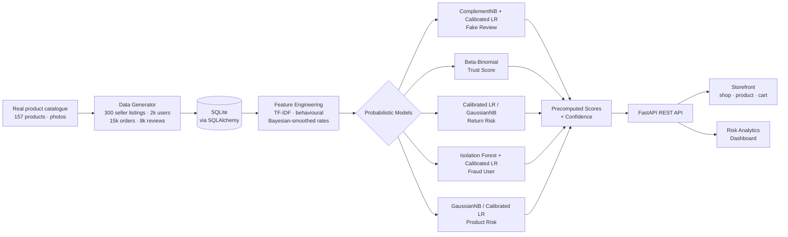

# TrustLens — Intelligent Consumer Trust & Product Risk Assessment

### *Using Probabilistic Machine Learning*

A working **e-commerce storefront** plus a **risk-analytics dashboard** that scores
**product trust**, **return risk**, **fraud users** and **fake reviews** — where every prediction
ships with a **probability** and an **uncertainty estimate**, not a bare label. Built as a
final-year project and designed to be demoed live.

> **Tagline:** *Predict trust, returns and fraud — with confidence, not guesses.*

---

## ✨ Highlights

- **Real products**: 157 real catalogue products (real titles, brands, descriptions and
  photos) sold as **300 seller listings** — the same product from different sellers carries its
  own trust score, so shoppers can pick the most trusted seller.
- **Real storefront**: home, catalog with filters, product pages with photo gallery, seller
  comparison and an ML trust panel, cart and checkout. Photos are bundled — works **offline**.
- **5 probabilistic ML modules** trained on realistic synthetic shopper behaviour.
- Every score is **calibrated** (`CalibratedClassifierCV`) and comes with a **confidence level**.
- **Bayesian trust** (Beta-Binomial) with a 95% credible interval, down-weighting likely-fake reviews.
- **Analytics dashboard** — KPIs, charts, fraud network graph, model performance, ⌘K palette, light/dark.
- **One-command run** (`start.bat` / `start.sh`): installs, generates data, trains, launches both servers.
- Honest evaluation: each model is compared against a **non-probabilistic baseline**.

---

## 🏗️ Architecture



**Stack**

| Layer    | Technology |
|----------|-----------|
| Backend  | Python 3.11, FastAPI, scikit-learn, scipy, numpy, pandas, joblib |
| Storage  | SQLite via SQLAlchemy |
| Frontend | React + Vite + TypeScript, Tailwind CSS, Recharts, Framer Motion, lucide-react |

---

## 🚀 Quick start (one command)

**Windows**

```bat
start.bat
```

**macOS / Linux / Git-Bash**

```bash
./start.sh
```

The script will:
1. create a Python virtual environment and install backend dependencies,
2. generate the synthetic dataset and train all models (first run only, ~40s),
3. install frontend dependencies,
4. launch the API on **http://127.0.0.1:8000** and the web app on **http://localhost:5173**.

Open **http://localhost:5173** in your browser.

### Manual run

```bash
# backend
cd backend
python -m venv .venv
.venv/Scripts/python -m pip install -r requirements.txt   # Windows
# .venv/bin/python -m pip install -r requirements.txt      # macOS/Linux
.venv/Scripts/python -m uvicorn app.main:app --port 8000

# frontend (second terminal)
cd frontend
npm install
npm run dev
```

> Interactive API docs are available at **http://127.0.0.1:8000/docs**.
> To force a clean rebuild of data + models, delete `backend/data/` and `backend/artifacts/`.

---

## 🧠 ML Modules

| # | Module | Approach | Output |
|---|--------|----------|--------|
| A | **Fake Review Detection** | ComplementNB on TF-IDF text (out-of-fold) stacked with a calibrated Logistic Regression over behavioural features (burst score, rating deviation, verified flag, length, generic-word ratio). | `P(fake)` + reasons + highlighted words |
| B | **Product Trust (Bayesian)** | Beta-Binomial with a `Beta(2,2)` prior; each review weighted by `1 − P(fake)`. | Trust 0–100, 95% credible interval, confidence, naïve vs Bayesian rating |
| C | **Return Risk** | Calibrated Logistic Regression **vs** Gaussian Naïve Bayes (best by ROC-AUC); features include log-price, Bayesian-smoothed user & product return rates, discount, COD, delivery time, size-complaint ratio. | `P(return)` + log-odds factor contributions + action |
| D | **Fraud User Detection** | Isolation Forest anomaly score **fused** into a calibrated Logistic Regression over Bayesian-smoothed return rate, 3-day returns, shared device/address counts, review burst, coupon-per-order. | `P(fraud)`, tier, triggered patterns with evidence |
| E | **Product Risk** | Gaussian Naïve Bayes **vs** calibrated Logistic Regression (best by **Brier score**, since the output is used as a probability) per seller listing, over negative-keyword ratio, return rate, defect-reason ratio, seller rating, trust. | `P(high risk)` + reasons |
| F | **Evaluation** | Accuracy, precision, recall, F1, ROC-AUC, confusion matrix, ROC & calibration curves, Brier score — vs a non-probabilistic baseline (plain SVM / naïve rule). | Served at `/api/models/metrics` |

### Representative metrics (seed = 42)

25% held-out test split; product risk uses **5-fold stratified cross-validation** because it has
only 300 listings (30 risky), where a single split would score just ~7 positives.

| Module | Model | ROC-AUC | F1 | Brier | Baseline F1 / Brier |
|--------|-------|:------:|:--:|:-----:|:-------------------:|
| Fake Review | ComplementNB + Calibrated LR | 0.93 | 0.61 | 0.064 | 0.51 / 0.213 (SVM) |
| Return Risk | Calibrated Logistic | 0.82 | 0.59 | 0.160 | 0.50 / 0.167 (SVM) |
| Fraud User | Isolation Forest + Calibrated LR | ~1.0 | 0.96 | 0.002 | 0.71 / 0.027 (naïve rule) |
| Product Risk | Gaussian Naïve Bayes | 0.89 | 0.79 | 0.041 | 0.78 / 0.106 (SVM) |

Every probabilistic model beats its non-probabilistic baseline on **both F1 and Brier score**
(calibration) — the Brier gap is largest, which is exactly what matters when a probability
triggers a real action.

---

## 🔌 API Endpoints

| Method | Path | Description |
|--------|------|-------------|
| GET | `/api/overview` | KPIs, risk distributions, trend, top risky products / fraud users |
| GET | `/api/products?search=&category=&sort=&distinct=` | Listings with trust & risk scores (`distinct=true`: one card per real product + seller count) |
| GET | `/api/products/{id}` | Brand, description, photo gallery, trust + interval, risk, reviews with `P(fake)`, every seller's offer with its own trust |
| GET | `/api/users?tier=&search=&sort=` | User list with fraud probability |
| GET | `/api/users/{id}` | Fraud probability, patterns, order history, linked accounts |
| POST | `/api/predict/return` | Body → `P(return)`, factors, recommended action |
| POST | `/api/predict/review` | Review text + meta → `P(fake)`, explanation |
| GET | `/api/models/metrics` | All evaluation metrics and curve data |

---

## 🖥️ Pages

### Storefront (`/`)
- **Home** — hero, shop-by-category, deals of the day, top brands, top rated.
- **Catalog** (`/shop`) — 4-column grid of real products with category filters, sort, search, load more.
- **Product** (`/product/:id`) — photo gallery, brand, description, MRP/discount pricing, add to cart / buy now,
  TrustLens ML panel, **"Available from N sellers"** comparison with per-seller trust, reviews with fake badges.
- **Cart** (`/cart`) — quantities, order summary, savings, place order.

### Project page (`/project`, linked from the store footer)
- Project introduction, module cards and editable **student / guide / college credits**.

### Risk analytics (`/dashboard`, linked as "Risk Analytics")
1. **Store** link back to the shop from the top bar.
2. **Overview** — 5 KPIs, return-by-category, fraud-tier donut, trust histogram, returns trend, top-10 tables.
3. **Trust & Risk Explorer** — searchable product grid → detail with animated trust gauge + credible band, naïve-vs-Bayesian, reviews with fake badges, "why this score?".
4. **Return Risk Predictor** *(live demo)* — form with sliders, try-example buttons, animated probability gauge, factor bars, action card.
5. **Fraud User Detection** — tiered user list → detail with fraud gauge, pattern chips, timeline, linked-account network graph.
6. **Fake Review Checker** — paste text → `P(fake)` with highlighted suspicious words.
7. **Model Performance** — per-model metrics, ROC curves, confusion heatmaps, calibration curves, probabilistic-vs-traditional section.
8. **How It Works** — pipeline diagram and plain-English explanations.

---

## 📸 Screenshots

> Add screenshots here after running the app (e.g. `docs/overview.png`, `docs/predictor.png`).

| Dashboard | Return Predictor | Model Performance |
|-----------|------------------|-------------------|
| _add image_ | _add image_ | _add image_ |

---

## 🎓 Viva Q&A

**Q: Why probabilistic ML instead of plain classification?**
A real decision ("block this user", "require prepaid") needs to weigh *how sure* we are. A point
label discards that. Calibrated probabilities let us set thresholds, rank by risk, and show
uncertainty — so a 95% case and a 51% case are treated differently.

**Q: Why a Beta prior for trust?**
The Beta distribution is the conjugate prior of the Binomial, so updating with positive/negative
reviews is analytic and cheap. A `Beta(2,2)` prior encodes "assume roughly average until proven
otherwise", which shrinks sparse products toward neutral and yields a credible interval for free.

**Q: How is fraud different from just a high return rate?**
A high return *ratio* can come from a genuine shopper with one unlucky order. Fraud is a **pattern**:
fast wardrobing returns, shared devices/addresses across accounts, review bursts, coupon abuse — on
top of a **Bayesian-smoothed** return rate so low-evidence users aren't punished. We demonstrate this
with the "1 order, 1 return" case: naïve rate = 100%, smoothed rate ≈ population average → not flagged.

**Q: What data did you use and why synthetic?**
The **products are real**: 157 items (titles, brands, descriptions, photos) from the open,
MIT-licensed DummyJSON catalogue, sold as 300 seller listings. The **behaviour is synthetic**,
because real platforms never release labelled fraud / fake-review / return-outcome data (privacy +
liability). We generate a reproducible, seeded world (2k users, 15k orders, 8k reviews) where
ground-truth labels are known and realistic patterns are injected, with deliberate overlap so the
models can't trivially read the label off a giveaway feature. The original "Toys" category became
"Sports" because the open catalogue has no real toy products.

**Q: Why are the same products listed by several sellers?**
That's how marketplaces work, and it's the strongest demo of the project: trust and product risk
are scored **per seller listing**, so the same phone can be low-risk from one seller and risky
(fakes, poor handling) from another. The product page compares sellers and marks the most trusted.

**Q: How do you know the probabilities are trustworthy?**
We calibrate every classifier with `CalibratedClassifierCV` and report the **Brier score** and a
**calibration curve** — a model whose "70%" really happens ~70% of the time hugs the diagonal.

**Q: Limitations and future scope?**
Synthetic data can't capture every real-world nuance; text features are template-driven. Future work:
real transformer embeddings for reviews, graph neural networks for fraud rings, online/streaming
updates of the Bayesian posteriors, and human-in-the-loop label feedback.

---

## 📁 Project structure

```
jyoshna/
├── backend/
│   ├── app/
│   │   ├── main.py            # FastAPI app + endpoints
│   │   ├── database.py        # SQLAlchemy models
│   │   ├── data_generator.py  # real catalogue → 300 listings + seeded behaviour
│   │   ├── catalog.json       # snapshot of 157 real products
│   │   ├── bootstrap.py       # generate → persist → train
│   │   ├── schemas.py         # Pydantic request bodies
│   │   └── ml/
│   │       ├── pipeline.py    # trains all models, metrics, scores
│   │       ├── inference.py   # runtime predictions
│   │       ├── fake_review.py # ComplementNB + calibrated LR
│   │       ├── trust.py       # Beta-Binomial
│   │       ├── metrics.py     # evaluation helpers
│   │       └── text_features.py
│   ├── scripts/fetch_catalog.py  # re-snapshot the catalogue + photos
│   └── requirements.txt
├── frontend/                  # React + Vite + TS + Tailwind
│   ├── public/catalog/        # 549 bundled product photos (offline-ready)
│   └── src/{pages,pages/store,components,lib,store}
├── start.bat / start.sh
└── README.md
```

---

*Built with probabilistic ML — trust, returns and fraud, with confidence.*
